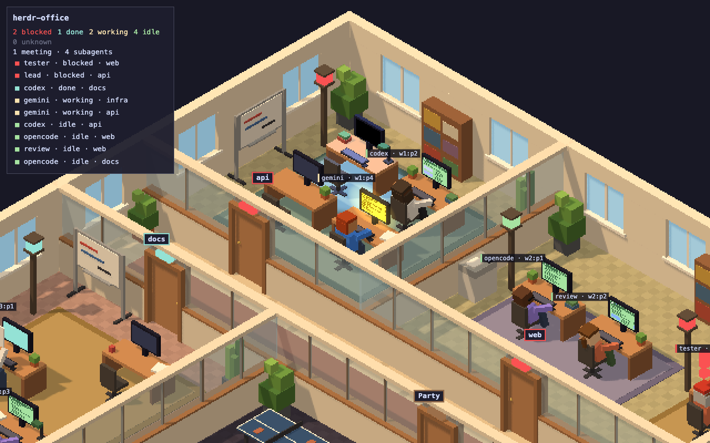

# herdr-office

herdr-office shows your herdr agents as workers in a 3D voxel office. Each workspace is a room, each tab is a pod, and each pane is a desk.



## Requirements

- macOS on Apple Silicon (`darwin-arm64`), or Linux x64 (`linux-x64`).
- herdr must run.

## Install and update

Run this command. The same command updates herdr-office.

```bash
curl -fsSL https://github.com/TheBabaYaga/herdr-office/releases/latest/download/install.sh | sh
```

The script puts the binary in `~/.local/bin`. If that folder is not on your `PATH`, the script prints a line for you to add to your shell config. The script does not change your shell config.

herdr-office asks GitHub for the latest release when it starts, and then once an hour. It sends no other data. When a newer version is out, the office shows this command in a dialog.

To see the version, run this command:

```bash
herdr-office --version
```

## Start

Run this command in a terminal:

```bash
herdr-office
```

On a Mac, the office opens in a tab of your default browser. On Linux, it opens in a Chromium app window. If Chromium is not installed, it opens in your default browser.

## Stop

Close the tab or the window. The command exits about 30 seconds later. You can also press Ctrl-C in the terminal.

## Open Anyway on a Mac

A binary from a browser download needs "Open Anyway" one time. Open System Settings > Privacy & Security and click "Open Anyway". Or run this command on the path of the file that you extracted:

```bash
xattr -d com.apple.quarantine <path to herdr-office>
```

The install command above does not need this step.

## Uninstall

Remove the binary:

```bash
rm ~/.local/bin/herdr-office
```
