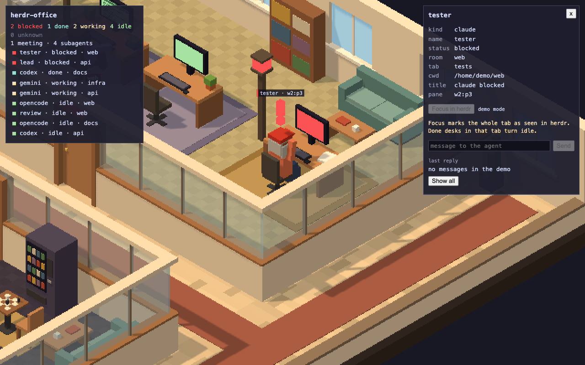
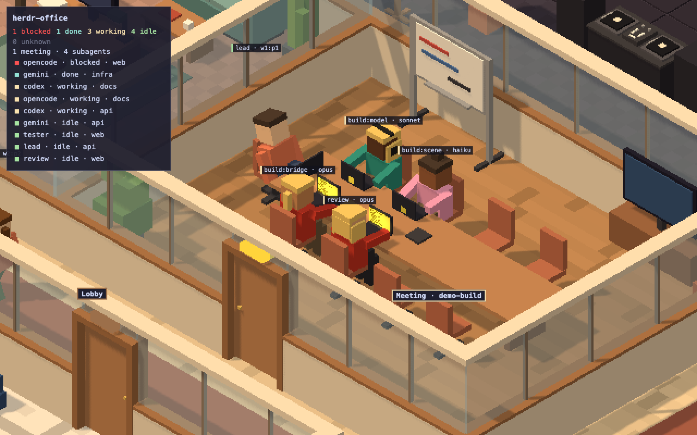
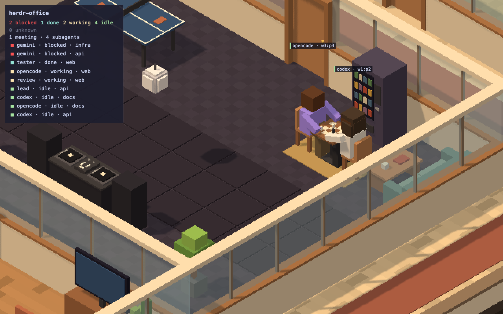
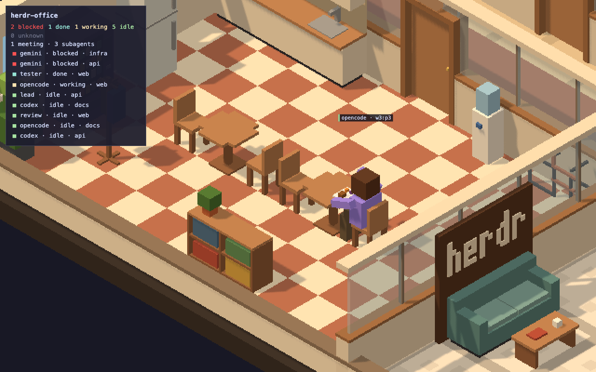
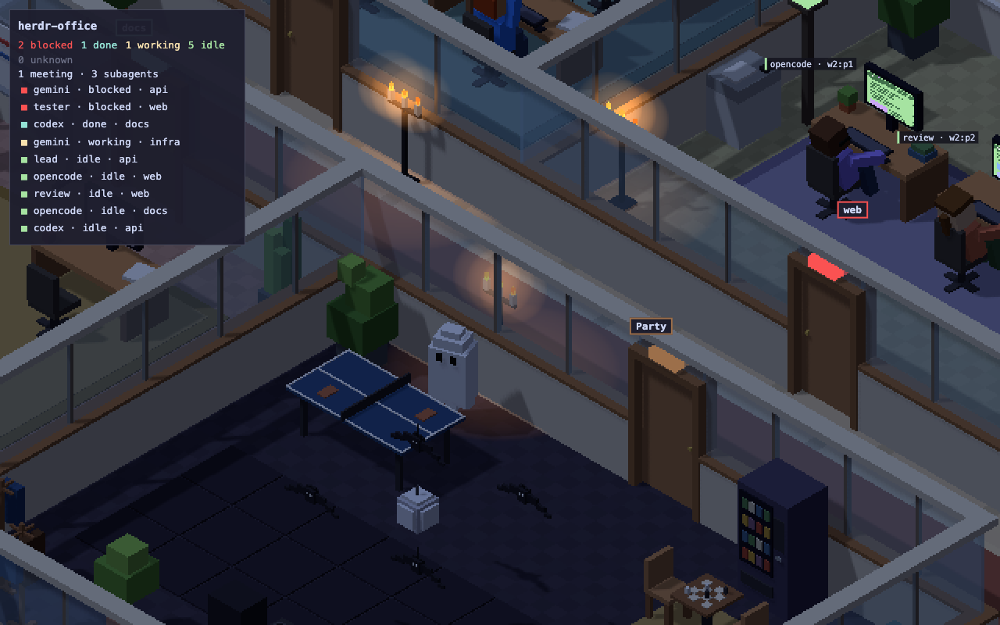

# herdr-office

herdr-office shows your herdr agents as workers in a 3D voxel office. Each workspace is a room, each tab is a pod, and each pane is a desk.


## What you see



Each desk shows the status of its agent. A blocked agent raises a hand, and its screen turns red. Click a desk to open the side panel. From the panel, you can focus the pane in herdr or send a message to the agent. The panel also shows the last reply of a Claude or Codex agent.



When a Claude session runs subagents, its agent leaves the desk and sits at the head of a meeting table. Each subagent sits at the same table, with its name and its model.



An idle agent takes breaks. Two idle agents can play chess or ping-pong in a big room.



An idle agent can also get a drink at the kitchen counter, eat lunch, talk at the water cooler, or dance in the party room. When its status changes, it runs back to its desk.



From 24 October to 1 November, the office is dark, with candles, bats, and ghosts. From 1 December to 6 January, it has Christmas trees and snow.

## Requirements

- macOS on Apple Silicon (`darwin-arm64`), or Linux x64 (`linux-x64`).
- herdr must run.

## Install and update

Run this command. The same command updates herdr-office.

```bash
curl -fsSL https://github.com/TheBabaYaga/herdr-office/releases/latest/download/install.sh | sh
```

The script puts the binary in `~/.local/bin`. If that folder is not on your `PATH`, the script prints a line for you to add to your shell config. The script does not change your shell config.

herdr-office asks GitHub for the latest release when it starts, and then once an hour. It sends no other data. When a newer version is out, the office shows this command in a dialog.

To see the version, run this command:

```bash
herdr-office --version
```

## Start

Run this command in a terminal:

```bash
herdr-office
```

On a Mac, the office opens in a tab of your default browser. On Linux, it opens in a Chromium app window. If Chromium is not installed, it opens in your default browser.

## Stop

Close the tab or the window. The command exits about 30 seconds later. You can also press Ctrl-C in the terminal.

## Open Anyway on a Mac

A binary from a browser download needs "Open Anyway" one time. Open System Settings > Privacy & Security and click "Open Anyway". Or run this command on the path of the file that you extracted:

```bash
xattr -d com.apple.quarantine <path to herdr-office>
```

The install command above does not need this step.

## Uninstall

Remove the binary:

```bash
rm ~/.local/bin/herdr-office
```
